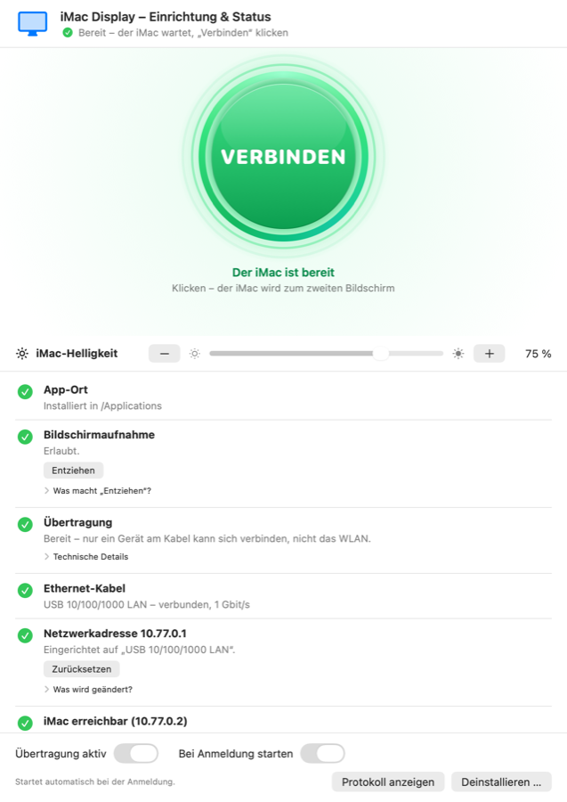
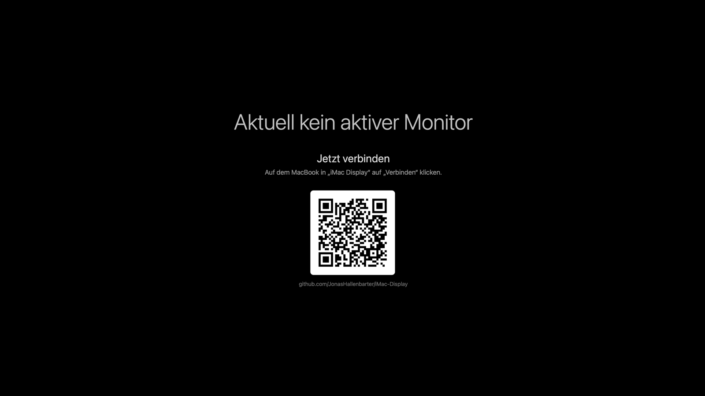
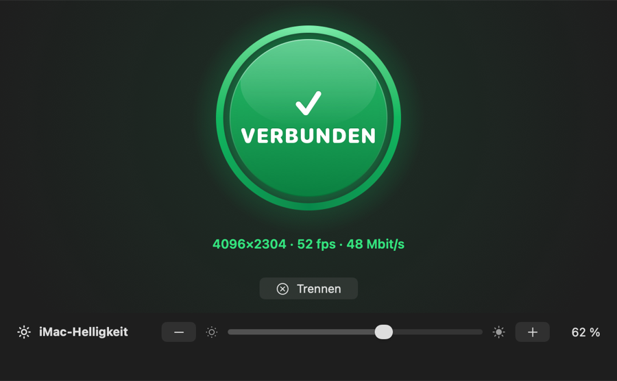

# iMac Display

**Machen Sie aus einem alten iMac einen 4K-Bildschirm für Ihr MacBook – per Netzwerkkabel, kostenlos und ohne Cloud.**

<p align="center">
  
  &nbsp;&nbsp;
  
</p>

---

## ⬇️ Download

| | Für welches Gerät? | Download |
|---|---|---|
| **Empfänger** | Der Mac, der zum Bildschirm wird: **iMac oder anderer älterer Mac** | [-2ea44f?style=for-the-badge&logo=apple&logoColor=white)](https://github.com/JonasHallenbarter/iMac-Display/raw/main/Download/iMac-Display-Empfaenger.dmg) |
| **Sender** | Der Mac, dessen Bild gezeigt wird: **MacBook** | [-0a84ff?style=for-the-badge&logo=apple&logoColor=white)](https://github.com/JonasHallenbarter/iMac-Display/raw/main/Download/iMac-Display-Sender-MacBook.dmg) |

Direkte Links: [iMac-Display-Empfaenger.dmg](https://github.com/JonasHallenbarter/iMac-Display/raw/main/Download/iMac-Display-Empfaenger.dmg) · [iMac-Display-Sender-MacBook.dmg](https://github.com/JonasHallenbarter/iMac-Display/raw/main/Download/iMac-Display-Sender-MacBook.dmg)

---

## ✨ Das Wichtigste in Kürze

- 🖥️ **4K-Qualität und geringe Latenz:** 4096 × 2304 Pixel, pixelgenau. Kodieren und Dekodieren läuft in der Grafik-Hardware.
- 🔌 **Direkt per Netzwerkkabel:** Es funktioniert unabhängig vom WLAN und ohne Internet.
- 🔒 **Alle Daten bleiben auf Ihren Geräten:** Es ist kein Server und kein Konto nötig.
- 🕵️ **Wir erfassen keine Daten:** Das Projekt ist zu 100 % Open Source.
- 💚 **100 % kostenlos:** Es gibt keine versteckten Premium-Funktionen. Es freut uns, wenn Sie einen alten Mac wiederverwenden können.
- 📡 **Auch für Macs ohne AirPlay:** „AirPlay zum Mac“ gibt es nur auf neueren Modellen (etwa iMac ab 2019). iMac Display läuft auch auf älteren Macs wie dem iMac 4K von 2015 oder 2017.
- 🔁 **Einmal verbinden, danach automatisch:** Wird das Kabel getrennt und wieder eingesteckt, verbindet es sich von selbst wieder.
- ☀️ **Helligkeit des iMac** lässt sich bequem am MacBook einstellen.
- 🌙 **Automatisch aus:** Kommt 10 Minuten lang kein Bild, schaltet sich der iMac aus (mit Countdown, abschaltbar).

> **Hinweis:** Dieses Projekt wurde mit **Claude Code (Opus 5.5)** umgesetzt. Es gibt **keine Gewähr auf die Code-Qualität**.

---

## ✅ Voraussetzungen

| | Sender (MacBook) | Empfänger (iMac / alter Mac) |
|---|---|---|
| **Gerät** | Mac mit Apple-Chip (M1 oder neuer) | Jeder Mac mit Intel- oder Apple-Chip, ideal ein iMac mit 4K- oder 5K-Bildschirm |
| **System** | macOS 13 Ventura oder neuer | macOS 12 Monterey oder neuer |
| **Anschluss** | Ethernet (USB-C-/Thunderbolt-Adapter geht) | Ethernet |

Dazu brauchen Sie ein **normales Netzwerkkabel** (Cat 5e oder besser), das direkt von Mac zu Mac führt. Ein Router ist nicht nötig.

**Unterstützt:** macOS-Geräte. Eine Version für Linux oder Windows gibt es aktuell nicht.

---

## 🚀 So einfach geht's

### 1. Empfänger auf dem iMac installieren

1. Laden Sie **`iMac-Display-Empfaenger.dmg`** herunter (oben) und öffnen Sie die Datei.
2. Ziehen Sie **„iMac Display Empfänger“** in den Ordner **Programme**.
3. Beim **ersten Start** klicken Sie die App mit der **rechten Maustaste** an und wählen **Öffnen** und dann noch einmal **Öffnen** (siehe [Warum warnt macOS?](#-warum-warnt-macos-beim-ersten-öffnen)).
4. Im Fenster arbeiten Sie die Liste von oben nach unten ab. Jede Zeile wird grün, sobald alles passt:
   - **Netzwerkadresse → Einrichten** (fragt nach Ihrem Passwort)
   - **Autostart einschalten**
   - **Monitor-Modus starten**

### 2. Sender auf dem MacBook installieren

1. Laden Sie **`iMac-Display-Sender-MacBook.dmg`** herunter (oben) und öffnen Sie die Datei.
2. Ziehen Sie **„iMac Display“** in den Ordner **Programme** und starten Sie die App. Oben in der Menüleiste erscheint ein Bildschirm-Symbol.
3. Im Fenster **„Einrichtung & Status“**:
   - **Bildschirmaufnahme → Erlauben …**: Schalten Sie in den Systemeinstellungen „iMac Display“ ein und klicken Sie danach auf **Neu starten**.
   - **Netzwerkadresse → Einrichten** (fragt nach Ihrem Passwort)

### 3. Verbinden

Stecken Sie das Netzwerkkabel ein. Sobald der iMac bereit ist, leuchtet auf dem MacBook der große grüne Knopf auf. Klicken Sie auf **VERBINDEN**, und schon zeigt der iMac Ihren zweiten Bildschirm. 🎉

<p align="center">
  
</p>

Ab jetzt verbindet sich alles automatisch, sobald das Kabel steckt. Den Bildschirm anordnen können Sie unter *Systemeinstellungen → Displays*.

---

## 🔐 Datenschutz

- **Wir erfassen keine Daten.** Es gibt keine Analyse, keine Werbung, kein Konto und keine Verbindung ins Internet.
- **Beide Programme laufen lokal:** Der Empfänger läuft auf dem iMac, der Sender auf dem MacBook. Das Bild geht direkt über das Kabel von einem Gerät zum anderen.
- **Nur über das Kabel erreichbar:** Der Sender nimmt nur Verbindungen über die direkte Kabelverbindung an. Im WLAN, etwa im Café, kann niemand Ihren Bildschirm sehen.
- **Alles nachprüfbar:** Der gesamte Quellcode liegt hier offen.

---

## 🛡️ Sicher und jederzeit rückgängig zu machen

Beide Apps ändern nur etwas, wenn Sie auf einen Knopf klicken, und alles lässt sich im Fenster wieder rückgängig machen:

| Was | So machen Sie es rückgängig |
|---|---|
| Feste Netzwerkadresse | **Zurücksetzen** stellt Ihre vorherige Einstellung exakt wieder her |
| Bildschirmaufnahme (MacBook) | **Entziehen** |
| Start bei Anmeldung / Autostart | Schalter aus |
| Automatisch wiederverbinden | **Trennen** |
| Automatisch ausschalten (iMac) | Schalter aus |
| Alles entfernen | **Deinstallieren …**: Sie können jeden Teil einzeln wählen, die App landet im Papierkorb |

---

## ❓ Häufige Fragen

### 🍏 Warum warnt macOS beim ersten Öffnen?
Die Apps sind kostenlos und nicht bei Apple gegen Gebühr notarisiert. macOS fragt deshalb einmal nach:
- **macOS 12 bis 14:** Rechtsklick auf die App → **Öffnen** → **Öffnen**.
- **macOS 15 und neuer:** Öffnen Sie die App einmal per Doppelklick und schließen Sie die Meldung. Gehen Sie dann zu *Systemeinstellungen → Datenschutz & Sicherheit*, scrollen Sie nach unten und klicken Sie auf **Dennoch öffnen**.

Danach startet die App ganz normal.

### Der grüne Knopf leuchtet nicht.
Schauen Sie im Fenster auf dem MacBook nach: Die rote oder orange Zeile zeigt unter **„Was tun?“**, woran es liegt, zum Beispiel am Kabel, an der Netzwerkadresse oder daran, dass die iMac-App nicht gestartet ist.

### Das Bild ruckelt.
Drücken Sie auf dem iMac im Vollbild die Taste **`s`**. Dann sehen Sie Bildrate, Datenrate und Fehler. Die Zeile **„Video-Dekodierung“** im Fenster des Empfängers zeigt, ob der Mac 4K in der Hardware dekodieren kann.

### Wie beende ich den Vollbildmodus auf dem iMac?
Mit **Cmd + Q**. Danach erscheint wieder das Statusfenster.

### Die Helligkeit springt zurück.
Schalten Sie auf dem iMac *Systemeinstellungen → Monitore → Helligkeit automatisch anpassen* aus.

Ausführliche Anleitung und weitere Lösungen: [docs/ANLEITUNG.md](docs/ANLEITUNG.md)

---

## 🛠️ Für Entwickler

```
Sources/imac-display/   Sender (Swift): virtueller Bildschirm, ScreenCaptureKit, H.264 (VideoToolbox), WebSocket-Server, Einrichtungsfenster
Receiver/               Empfänger (Swift, macOS 12, Universal): eigener Vollbild-Player, Einrichtung, Autostart
scripts/macbook/        build-app.sh – baut den Sender und die DMG
docs/PROTOCOL.md        Architektur und Übertragungsprotokoll
```

Selbst bauen (Xcode oder Command Line Tools):

```bash
scripts/macbook/build-app.sh      # Sender  → dist/iMac-Display-MacBook.dmg
Receiver/build-dmg.sh             # Empfänger → dist/iMac-Display-Empfaenger.dmg
```

Testen ohne Bildschirmaufnahme: `imac-display --test-pattern`, dann `http://127.0.0.1:8080/` im Browser öffnen. Alle Optionen zeigt `imac-display --help`.

---

## 📄 Lizenz

[MIT](LICENSE): frei nutzbar, veränderbar und weitergebbar, ohne Gewähr.
